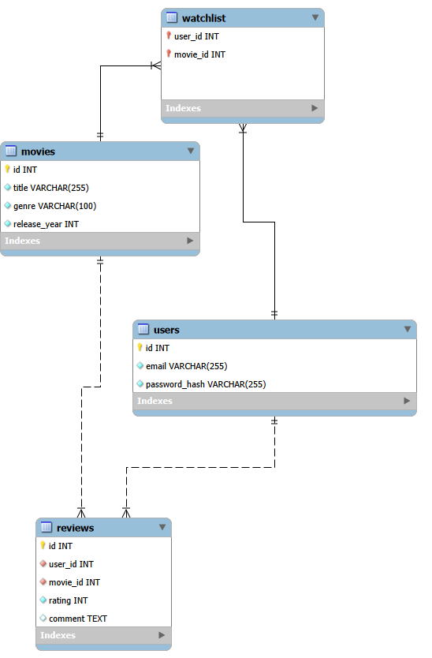

# FilmRecensioner

## About the project

FilmRecensioner is a backend project where users can register, log in and manage their movie reviews. Users can also browse the movies in the database and save movies to their own watchlist.

The project is a REST API built with Node.js, Express and MySQL. There is no frontend; the API is tested with Postman.

## Technologies

- Node.js
- Express
- MySQL
- JavaScript
- bcrypt for hashing passwords
- JWT (jsonwebtoken) for login and authentication
- dotenv for environment variables
- mysql2 for the database connection

## Database

The database is called `filmrecensioner` and has four tables:

- **users** – stores users and their password hashes.
- **movies** – stores information about the movies.
- **reviews** – stores the users' reviews and ratings.
- **watchlist** – keeps track of which movies each user has saved.

The SQL code that creates the database, the tables and three sample movies is in `database/setup.sql`.

### ER diagram



- One user can write many reviews and save many movies.
- One movie can have many reviews and be in many watchlists.
- `users.email` is unique, so the same email can't be registered twice.
- `reviews (user_id, movie_id)` is unique: **one review per user per movie**. The API answers 409 if a user tries to review the same movie again; to change their opinion, they edit their review instead.
- `watchlist (user_id, movie_id)` is the primary key, so the same movie can't be saved twice. The API answers 409 in that case.
- The rating must be between 1 and 10 (`CHECK` in the database, and validated in the API).

## Installation

1. Clone the project from GitHub.
2. Open the project folder in VS Code.
3. Install the packages:

```bash
npm install
```

4. Copy `.env.example` to a new file called `.env` in the project's main folder and fill in your own values:

```env
DB_HOST=localhost
DB_USER=root
DB_PASSWORD=your_mysql_password
DB_NAME=filmrecensioner
JWT_SECRET=your_secret_jwt_key
```

5. Run the SQL code in `database/setup.sql` (for example in MySQL Workbench) to create the database, the tables and the sample movies.

## Start the server

Start the server with:

```bash
npm start
```

(or `node server.js`)

The server runs on:

```text
http://localhost:3000
```

## API routes

### Authentication

| Method | Route | Description | Access |
|---|---|---|---|
| POST | `/api/auth/register` | Register a user | Public |
| POST | `/api/auth/login` | Log in and receive a token | Public |

### Movies

| Method | Route | Description | Access |
|---|---|---|---|
| GET | `/api/movies` | Get all movies | Public |
| GET | `/api/movies/:id` | Get one movie | Public |

### Reviews

| Method | Route | Description | Access |
|---|---|---|---|
| GET | `/api/movies/:movieId/reviews` | Get the reviews for a movie | Public |
| POST | `/api/movies/:movieId/reviews` | Create a review | Logged in |
| PUT | `/api/reviews/:id` | Update your own review | Owner only |

### Watchlist

| Method | Route | Description | Access |
|---|---|---|---|
| GET | `/api/watchlist` | Get your watchlist | Logged in |
| POST | `/api/watchlist/:movieId` | Add a movie | Logged in |
| DELETE | `/api/watchlist/:movieId` | Remove a movie | Logged in |

Routes that need login require a JWT token in the header:

```text
Authorization: Bearer <token from login>
```

### Request bodies

Register / login:

```json
{ "email": "anna@test.com", "password": "password123" }
```

The email must be valid and the password at least 8 characters.

Create / update a review:

```json
{ "rating": 8, "comment": "Great movie!" }
```

The rating must be a whole number from 1 to 10, and the comment is required.

### Status codes

| Code | Meaning |
|---|---|
| 200 | OK |
| 201 | Created (user, review or watchlist item) |
| 400 | Invalid input (id, email, password, rating, comment or broken JSON) |
| 401 | Not logged in, or invalid/expired token |
| 403 | Trying to edit someone else's review |
| 404 | Movie, review, watchlist item or route not found |
| 409 | Email already registered, movie already reviewed, or movie already in watchlist |
| 500 | Server error (details are only logged on the server) |

## Security

- Passwords are hashed with bcrypt and never stored in plain text.
- JWT is used to check which user is logged in. The user's id is always taken from the verified token, never from the request body.
- Before a review is updated, the server checks that it belongs to the logged-in user with `Review.isOwnedBy()` (otherwise 403).
- Public review lists only show the reviewer's user id, never their email address.
- All SQL queries use parameters (`?`), so user input is never put directly into the SQL code. This protects against SQL injection.
- Unexpected errors are only logged on the server; the client gets a general error message and never sees SQL details.
- Database credentials and the JWT secret are stored in `.env`, which is excluded from GitHub by `.gitignore`. `.env.example` only contains placeholders.
